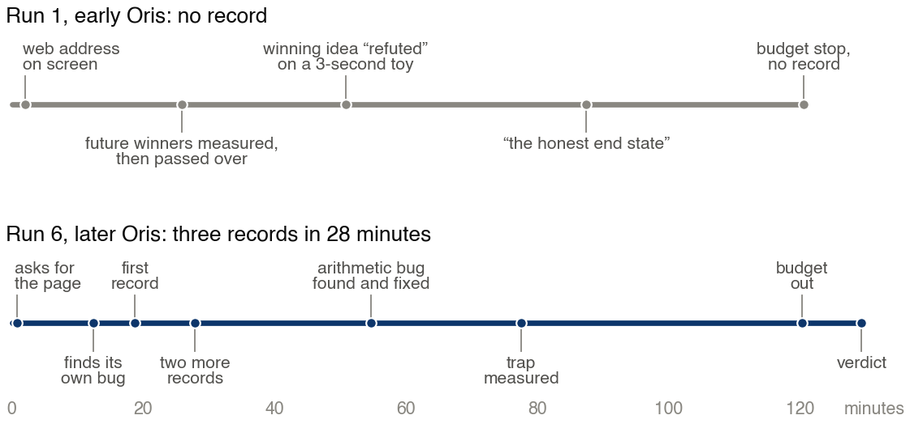

# One Photo Fewer

**Inside the Oris harness, open-weight models set 29 new records for a thirty-year-old table of mathematics**

Pantheon Labs, AI Research Lab · November 2026

[](https://github.com/Ehsan187228/one-photo-fewer/actions/workflows/verify.yml)

**[Read the paper (PDF)](paper/One_Photo_Fewer.pdf)** · **[Check the records](#verify-the-records)**

How few photos of nine can show every three of 41 guests together at least once? The best known answer was 168. In a single two-hour run inside **Oris**, the research harness built at Pantheon Labs, two open-weight language models found 167 and then broke two more public records, all within 28 minutes and with no person steering.

GLM-5.3 wrote the search program, diagnosed and fixed its own bug from the program's log and chose where to aim it, while DeepSeek-V4.1-Flash scouted the literature. Across six runs in 47 hours, GLM-5.3 went from no record under an early version of Oris to 29 records in the next five runs, with DeepSeek-V4.1-Flash on the team.

## Highlights

- **3 public records broken in 28 minutes**, in a single run with no person steering
- **16 records in one two-hour run**
- **29 records in five runs**, with records in every run after the first
- **216 photos saved** against the best known values
- **79 photos cut from a single entry**: C(41,12,5), from 2,207 to 2,128
- **Every record comes with a certificate**: the three headline records check in under a second, all 29 in about a minute and a half, with no model and no Oris

```sh
git clone https://github.com/Ehsan187228/one-photo-fewer
cd one-photo-fewer/supplement
python3 verify.py    # the three headline records, under a second
```

## Headline results

These are covering designs: $C(v,k,t)$ is the smallest number of blocks of size $k$ from $v$ points such that every $t$ points lie together in some block.

| Entry | Previous best | Holder | New |
|---|---|---|---|
| $C(41,9,3)$ | 168 | Giovanni Acerbi, 2023 | **167** |
| $C(44,11,3)$ | 110 | Alessandro Jurcovich, 2022 | **109** |
| $C(42,12,3)$ | 75 (table: 76) | WitnessFlow, 2026 | **74** |

A record here means below the lowest public value found on 3 November 2026. All 29 records are listed in [`supplement/records.csv`](supplement/records.csv) and in the appendix of the paper.



*Run 1 under an early version of Oris; Run 6 under a later one, with DeepSeek-V4.1-Flash on the team.*

## What changed with Oris

Between Run 1 and Run 6 the Oris setup moved fast: five new versions of the harness in 45 hours, DeepSeek-V4.1-Flash on the team from Run 2, longer source lists and changes to its web search service. The logs show what the new setup did differently:

- **A key source opened at once.** Run 1 had van Staden's web address on screen and never opened it. Every later run asked for it within 1.3 minutes.
- **Faults caught while the work ran.** In Run 6, checks on running jobs caught a search that never searched and swapped arguments that would have sent results to the wrong file.
- **Results banked faster.** Up to 25 minutes in Run 5, 1 to 2 minutes in Run 6.
- **Run 6 ended on a verdict.** Its final check rebuilt the program and regenerated a record byte for byte in 21 seconds.

## Verify the records

Run these from `supplement/`. The checks need Python 3.9 or later and nothing else: no network, no model, no Oris. Only the last command also needs a C compiler.

```sh
python3 verify.py                  # the three headline records, under a second
python3 verify.py --all            # all 29 records, about a minute and a half
python3 verify.py --others         # adds nine further valid designs not counted among the 29, about a minute
python3 verify.py --self-test      # tests the checker on good and broken designs
python3 check_structure.py         # the grids, the twins and the trap, a few seconds
sh solver/regenerate_42_12_3.sh    # reruns GLM-5.3's search for the 74-block record, about half a minute
```

`--self-test`, `--all`, `check_structure.py` and the regeneration script run automatically on every push to `main`.

## Contents

| Path | What it holds |
|---|---|
| [`paper/`](paper) | The paper as PDF, its LaTeX source, the figures and the script that rebuilds them |
| [`supplement/`](supplement) | Certificates for all 29 records, starting designs, data tables, the search programs and the check scripts |

To rebuild the paper, run `tectonic One_Photo_Fewer.tex` in `paper/`. To rebuild the figures, run `python3 make_figures.py` there, which needs matplotlib.

## About Oris

Oris is the research harness built at Pantheon Labs, and it is already at work on other problems. It stays in-house: its internals, prompts and raw logs are private, and every design here checks without it.

## Citation

```bibtex
@misc{pantheonlabs2026onephotofewer,
  title  = {One Photo Fewer: Inside the Oris Harness, Open-Weight Models Set 29 New Records for a Thirty-Year-Old Table of Mathematics},
  author = {{Pantheon Labs}},
  year   = {2026},
  url    = {https://github.com/Ehsan187228/one-photo-fewer}
}
```

## Credit and terms

Starting designs come from the La Jolla Coverings Repository (D. Gordon, [doi:10.5281/zenodo.19735294](https://doi.org/10.5281/zenodo.19735294), CC BY 4.0) and its contributors, and from public work by WitnessFlow (car-b), Zarco, Özdemir and the V3R1T4S contributors. The method builds on Morris's breakout idea and on van Staden's published program. See [`LICENSE`](LICENSE) for the terms of this repository.

Contact: contact@pantheon-labs.io
